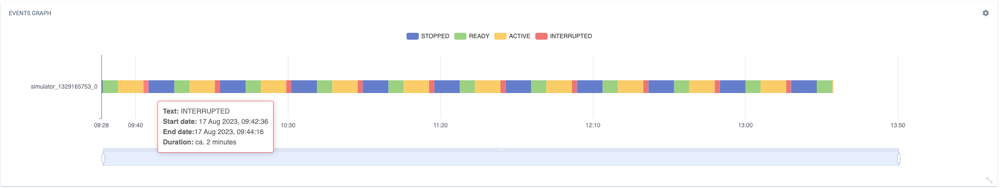
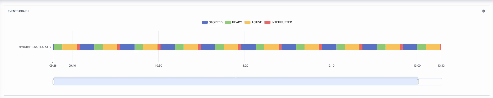
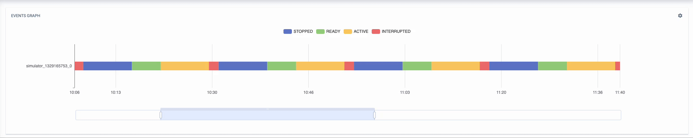

# Events Graph Widget

Shows the occurrence of device events as colored state bars on a zoomable timeline, using the
echarts [profile chart](https://echarts.apache.org/examples/en/editor.html?c=custom-profile)
approach. Each configured event type is one row; each event text (e.g. `RUNNING`, `STOPPED`) can
get its own label and color.



## Features

- Shows the "duration" of every event by assuming that a state lasts until the next event of the
  same type arrives — the newest state runs until now. The state active at the start of the
  window is looked up from the last event before it.
- One row per event type, several event types per widget, in the configured order
- Shared time cursor: hovering the chart draws a line across all rows and lists, above the chart,
  what every row shows at that moment — to correlate the event types
- On a group dashboard each row can take its events from a device of that group, so the states of
  several devices line up on one time axis (row label: `<type> · <device>`)
- Label and color per event text (default color: the tenant's primary brand color)
- Time window of the past 1–24 hours
- Optional auto refresh with a configurable interval and a manual reload button
- States can be toggled in the legend; the chart can be zoomed (slider or mouse wheel)
- Empty states for a missing device, missing event types and failed requests

The chart can be zoomed:


Interactive legend:


## Configuration

| Setting          | Description                                                        |
| ---------------- | ------------------------------------------------------------------ |
| Display duration | Window shown, in hours before now (1–24, default 4)                |
| Auto refresh     | Reloads the events periodically                                    |
| Refresh interval | Auto refresh interval in seconds (default 30)                      |
| Event Type       | Event `type` queried for the selected device; one chart row each   |
| Device           | Group dashboards only: the group's device this row's events come from (default: the group itself) |
| Event Text       | Event `text` value to style                                        |
| Label            | Legend / tooltip label for that text (falls back to the text)      |
| Color            | Bar color for that text                                            |

## Limitations

- Rows from different devices only on group dashboards, and only for devices of that group; on a
  device dashboard every row uses the target device
- A row without any event inside the window stays empty, even if an earlier event set a state that
  is still active — the state before the window is only looked up when the window has events
- Fetches at most 2000 events per type and window
- The dashboard's global time context is not used; the window is always "the past n hours"

## Development

From the repository root:

```bash
pnpm run serve:events-graph-widget   # needs C8Y_BASEURL and C8Y_SHELL_TARGET
pnpm run build:events-graph-widget
pnpm run test:events-graph-widget    # Karma unit tests
pnpm run e2e:mock events-graph-widget --browser=chrome   # Cypress against the tenant mock
```

Built on Cumulocity Web SDK 1024.21.x and Angular 21. The plugin exports
`EventsGraphWidgetPluginProviders` (context path `ps-iot-pkg-events-graph-widget-plugin`).

---

These tools are provided as-is and without warranty or support. They do not constitute part of
the Cumulocity product suite. Users are free to use, fork and modify them, subject to the license
agreement. While Cumulocity welcomes contributions, we cannot guarantee to include every
contribution in the main project.
